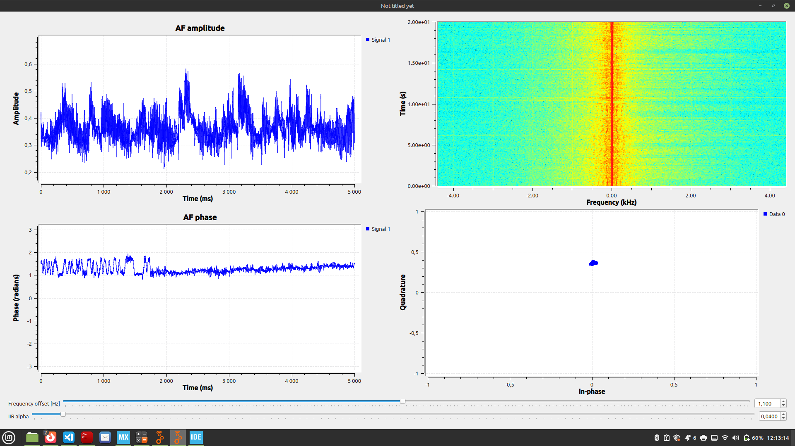

# PCSK225 Software-defined receiver/decoder

This is an implementation of fully software-based solution to demodulate longwave signal on 225 kHz and decode phase-modulated PCSK225 signals, including *e-Czas Radio* time reference signal using plain STM32 microcontroller.

## Features

* **There is no RF frontend at all!**. STM32 deals with pure RF pushed to ADC and demodulation to I/Q signal is fully software-based. No hardware DSP here, only DMA sampling,
* **NMEA 0183 - compatible UART output** - when synced, sends $GPRMC frame with current date and time,
* **1PPS output** - timer controlled - can be used (both with NMEA) to provide precise* time synchronization,
* **General-purpose UART** sends raw PCSK225 frames received (both e-Czas and third-party).
* **GNU Radio integration** - I/Q signal is sent over UART and can be pushed to GNU Radio software

**see **Accuracy** paragraph*

## How does it work

RF signal from ferrite-rod active antenna (see [this project](https://github.com/J-K-Kowalski/PCSK225-Antenna)), tuned to carrier freq, is pushed directly to ADC input (only with DC bias added) of STM32F303 MCU. It samples ADC with 2.25 MSPS and demodulates to I/Q signal. Next, the signals are low-pass filtered and the phase is calculated. The simple PLL stabilises low-freqency phase rolls and phase shifts are detected and converted to bits. The MCU has no sophisticated DSP features, so everything is software-based.

Received frames an decoded time are transmitted over UART.

There is also AM detector which sends low-quality (but audible) Polish Radio 1 program to DAC output.

## Usage
| STM32 pin | Role | Description |
| -- |--|--|
| PA0 | RF in | Here RF (with DC bias) comes to ADC |
| PA4 | AF audio out | Demodulated audio of regular Polish Radio 1 program broadcasted |
| PA1 | 1PPS output / LED | When synced, flashes once per second (see *Accuracy*), with rising edge at the actual begin of second, pulse lasts ~50 ms |
| PB6 | Carrier LED | High if local PLL has found a carrier and synced, low if signal lost
| PA7 | Rx LED | High when PCSK225 frame is received |
| PC7 | Error LED | High if there is no sync frame from 3 minutes from start or last sync was 1 hour ago |
| PA2 | I/Q output UART | Nucleo ST-Link UART: provides raw I/Q frame, can be pushed via `tools/iq2zmq.py` to ZeroMQ and then to GNU Radio - 961200 baud 8N1
| PA9 | General-purpose UART | Sends raw PCSK225 frames using format `:<header>:<payload>\r\n` in hex format - 115200 baud 8N1
| PB10 | NMEA 0183 output | GPS receivers - compatible output for time frames - 38400 baud 8N1

### GNU Radio integration
Running `tools/iq2zmq.py` fetches data from UART `/dev/ttyACM0` (may be changed) and opens ZeroMQ socket. There is GNU Radio project in `gnuradio/` dir which fetches ZeroMQ data and provides basic features (phase/amplitude chart, constellation, waterfall) and audio output.

## Accuracy

According to [e-Czas project hompage](https://e-czas.gum.gov.pl/e-czas-radio) the accuracy is <0.01 s. The 1PPS output is optimized to provide the best possible accuracy but there are some constraints, such as:

* distance from transmitter to receiver (wave propagation delay)
* accuracy of frame sent by transmitter site - [this](https://www.pa3fwm.nl/signals/poland225kHz/) research proves that there was accuracy issues just after signal has been launched.
* real begin of frame (see below)

There is no explanation of actual "zero point" of frame but comparing to full-hour beeps sent over Polish Radio 1 audio I assume that it is the **peak of first zero in sync burst**, but I am not entirely sure. To be confirmed by GUM (maintainer of the time code).

The microsecond precision (like GPS) cannot be reached here.

## Background

The long-wave transmitter located in Solec Kujawski, Poland transmits amplitude modulated audio of Polish Radio 1 on 225 kHz, covering most of Europe. It is also audilble over the world if there is good propagation. Additionally, the carrier sends data using phase modulation by system called PCSK225. 

For now the following informations are transmited:
* Time reference signal called *e-Czas radio* - transmitted since late 2023
* Frames identified as *Enea lighting control* - there is no information at all about frame format and exact purpose. Enea is a domestic DSO so it may be utillized for some remote control of street lighting (If you have more informations, feel free to contact).

### Modulation deatils

Details about procotol and modulation are available in Polish: [here](https://e-czas.gum.gov.pl/wp-content/uploads/2024/06/e-CzasPL-Opis-projektu-przykladowego-modulu-odbiorczego-e-Czas-Radio.docx-1.pdf) and [here](https://e-czas.gum.gov.pl/wp-content/uploads/2024/06/e-CzasPL-Opis-ramki-czasu-e-Czas-Radio.pdf).

Phase is shifted up by 36 degrees (1/10 of full period). Phase shift is zero, no phase shift is one. There is no manchester encoding - just pure bit-based shift keying. Phase is moving betwen neighbour zeros and ones linearly, which creates characteristic "triangle wave" during sync burst. The baudrate is 50 bps.

Frames may be transmitted in 20 time slots per minute (every 3 seconds). First slot starts exactly at full minute. There is no rule when each type of frame will be broadcasted - for now I have noticed that time code comes allways 3 seconds after full minute.

The whole frame contains 16-bit sync burst (0x5555 alternating zeros and ones), then 8-bit header which specifies type of frame (see above) and 72-bit payload. e-Czas utillizes it to transmit time code and additional time information, such as time zone (with change announcement twice a year) and leap seconds. One frame takes ~2 seconds to transmit.

## Future

It will be nice to add some display and design a PCB.